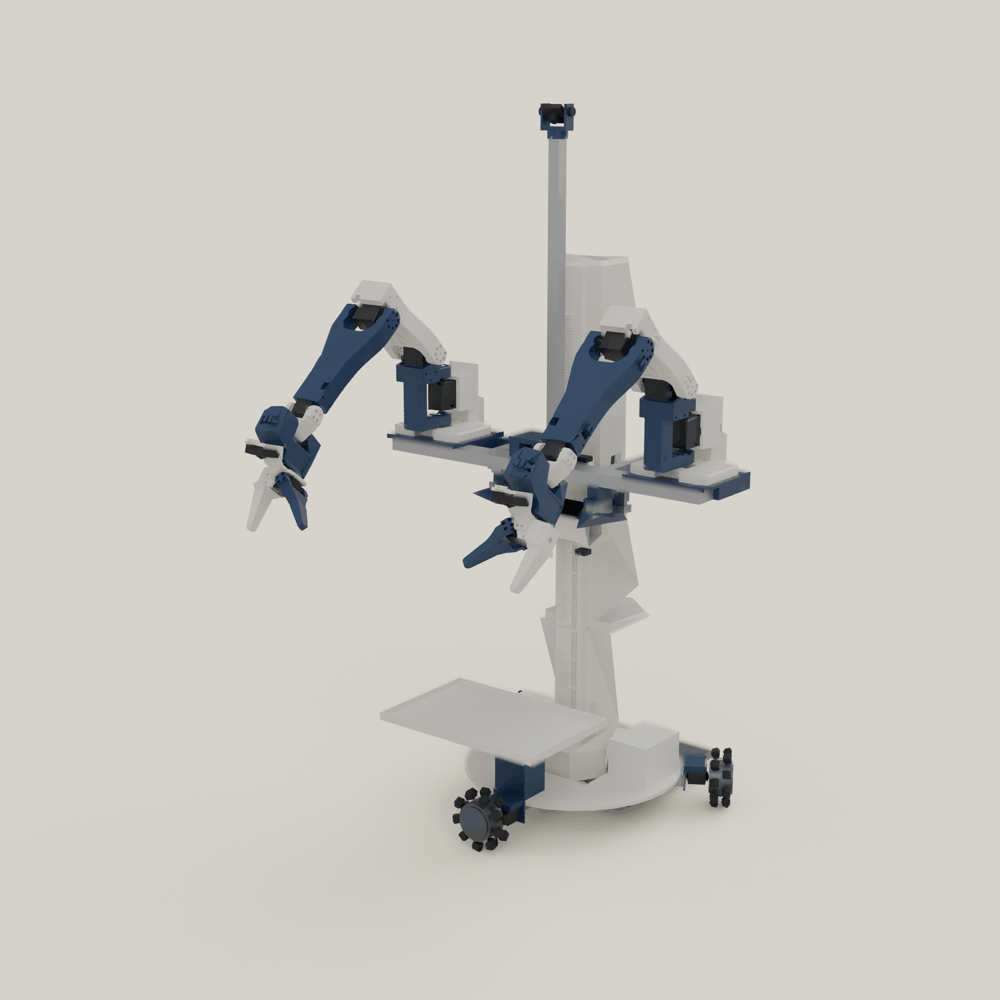

# Faibot M1

An open mobile robot with two arms and a lifting column, built for university robotics labs. This repository holds its CAD, simulation model, Python SDK, wiring diagrams and assembly guide.



**Status:** design v0.5, before the first engineering build. No physical robot has been assembled yet; everything here is checked in simulation and against the CAD.

## What's in this repository

| Folder | What it holds |
| --- | --- |
| [`hardware/`](hardware) | CAD as STEP: the whole robot, one file per part, a parts list and a URDF |
| [`sdk/`](sdk) | The `faibot-m1` Python package and command line: simulation, servo bus, kinematics, teleoperation |
| [`sim/`](sim) | MuJoCo model and meshes, plus a lab scene for pick-and-place tasks |
| [`electrical/`](electrical) | Wiring tables and cable drawings |
| [`product/`](product) | Specification, part register and assembly notes |
| [`docs/vi/`](docs/vi) | Documentation in Vietnamese: specifications, bill of materials, assembly guide |

## Quick start

```
./run.sh              # simulation window with keyboard teleoperation
./run.sh --selftest   # headless check, exit code 0 means it passed
```

The first run creates a virtual environment and installs the dependencies. Python 3.10 or newer is needed. Command-line details are in [`sdk/README.md`](sdk/README.md).

## Robot at a glance

- Two arms, each with six joints and a gripper (6+1, as in the original AM-ARM200), on a lifting column and a three-wheel omni base.
- 18 servos: 7 STS3095 and 11 STS3215, all on 12 V. Wrist yaw servos use IDs 21 and 22.
- Payload per arm (calculated, not measured): peak 2.0 kg at 0.25 m reach, continuous 0 kg at full reach, recommended 0.05 kg or less.
- Base speed up to 0.40 m/s and turn rate up to 0.25 rad/s, with an acceleration ramp that keeps the tip-over margin above 1.5 (static 1.64, dynamic 1.50).

## Platform

Faibotic is building a browser-based platform for this robot: calibration, teleoperation, dataset recording and policy training in one place. It is in development; follow it at [faibotic.com](https://www.faibotic.com).

## Documentation

The written documentation is currently in Vietnamese, starting at [`docs/vi/README.md`](docs/vi/README.md). The hardware and SDK READMEs are in English.

## License

| Folders | License |
| --- | --- |
| `sdk/`, `sim/`, `web-assets/`, `hardware/urdf/`, `hardware/tools/`, `scripts/`, `tests/` | [Apache License 2.0](LICENSE) |
| `cad/`, `hardware/` (except the items above and inherited parts), `electrical/`, `product/`, `docs/`, `media/` | [CC BY-NC-SA 4.0](LICENSE-hardware); commercial use needs a separate written agreement with Faibotic |
| `cad/upstream/`, `hardware/parts/inherited/` | Apache License 2.0, by their original authors |

The full folder list is in [`NOTICE`](NOTICE).

## Credits

The arm and the base frame build on open designs by liyiteng (AM-ARM and AlohaMini), and the servo mesh comes from MuJoCo Menagerie; sources and commits are listed in [`NOTICE`](NOTICE).
