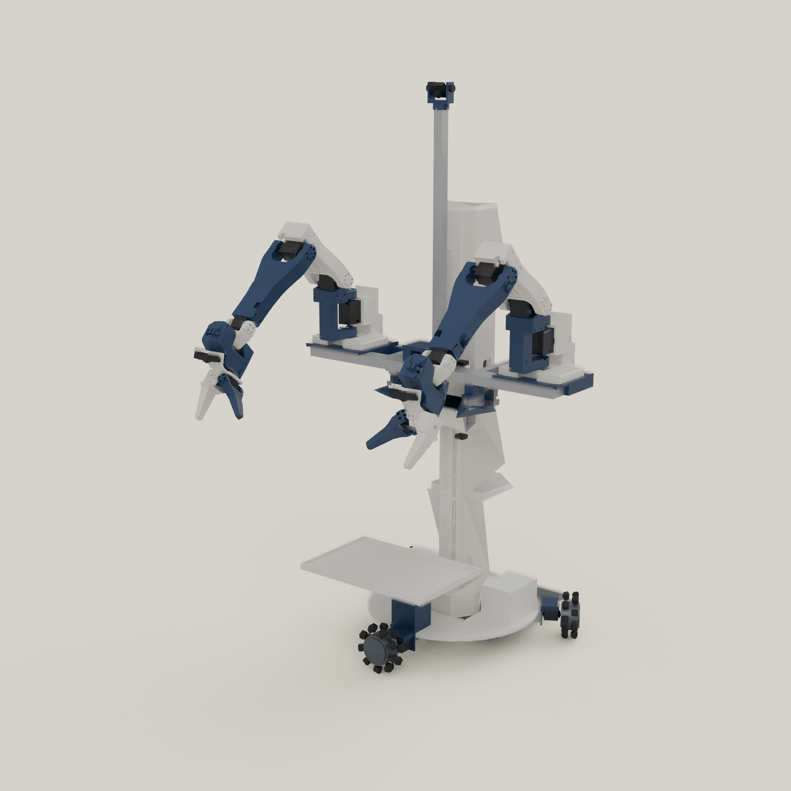
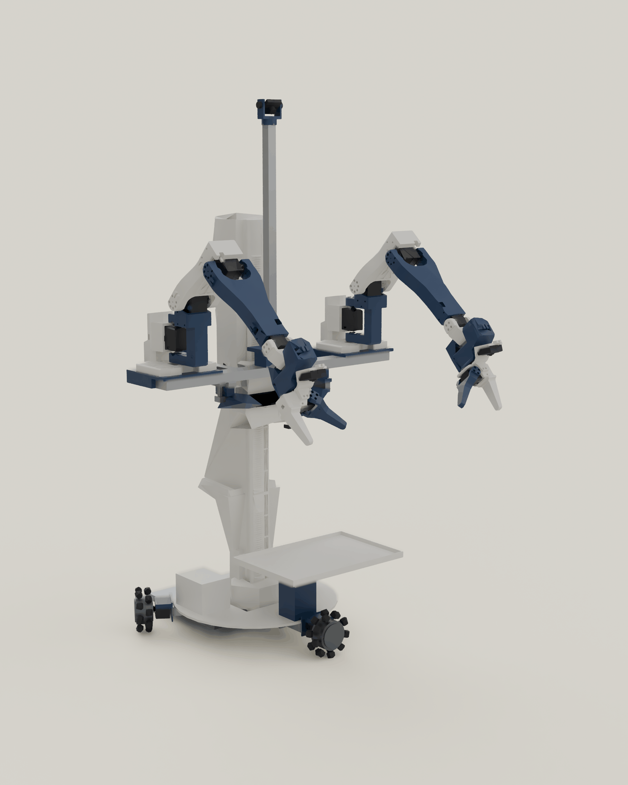
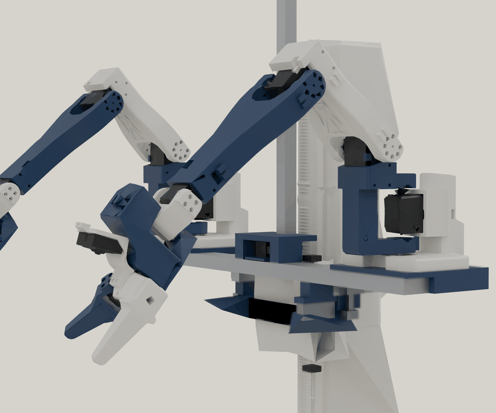
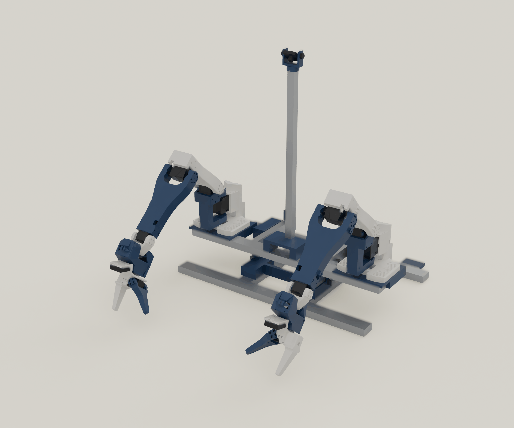

# Faibot M1

Robot di động hai tay có trụ nâng, thiết kế mở cho lab robot đại học: dạy học, thu dữ liệu teleop và huấn luyện policy trên cùng một robot. Repo gồm CAD, mô phỏng, SDK Python, sơ đồ điện, BOM và hướng dẫn lắp.



**Trạng thái: v0.5, trước EVT.** Mới có mô phỏng và thiết kế, chưa có robot thật, nên chưa phần nào được xác nhận trên phần cứng. Backend `feetech` của SDK mới test với bus giả.


Video mô phỏng (MuJoCo): [gắp đặt](../../media/video/m1-v05e-pick_place.mp4) · [phân loại](../../media/video/m1-v05e-sorting.mp4) · [mở nắp hộp](../../media/video/m1-v05e-open_close.mp4)

| Nghiêng 3/4 | Cánh tay và servo | Trạm hai tay trên bàn |
|---|---|---|
|  |  |  |

## Tài liệu

- [Thông số](specifications.md): tầm khớp, khoảng trục, tầm với, servo và ID, kẹp, tải, đế, trục nâng, điện.
- [BOM](bom.md): danh sách vật tư theo nhóm, số lượng, thông số và link mua.
- [Hướng dẫn lắp](assembly-guide.md) và bản in [PDF A5](M1_assembly_A5_v0.5.pdf).
- [Thay đổi ở v0.5](CHANGES-public.md).

## Phần cứng

[](../../media/hardware/TONG-QUAN.md)

Số lượng cho một robot chuẩn, lấy từ BOM, chia thành bốn tờ theo cụm: [trạm hai tay](../../media/hardware/m1-hw-tram@2x.png), [trục nâng](../../media/hardware/m1-hw-truc-nang@2x.png), [đế di động](../../media/hardware/m1-hw-de@2x.png), [điện chung](../../media/hardware/m1-hw-dien@2x.png). Dấu `*` là số giả định, `×?` là chưa xác định. Hai tờ tuỳ chọn: [bộ đế bàn](../../media/hardware/m1-hardware-de-ban@2x.png) và [gói leader](../../media/hardware/m1-hardware-leader@2x.png). Nguồn số liệu và cách tạo lại: [media/hardware/README.md](../../media/hardware/README.md).

## Thông số

Giá trị "Chờ EVT" sẽ có sau khi dựng và đo bộ đầu tiên.

| Cụm | v0.5 P-L |
|---|---|
| Tay | 2 tay AM-ARM200 nguyên bản, vai và khuỷu mỗi khớp một servo |
| Bậc tự do mỗi tay | 6 khớp + kẹp (6+1), đủ khớp yaw cổ tay như AM-ARM200 gốc |
| Kẹp | Kẹp gốc AM-ARM200 (thân J7, hàm J7, giá camera cổ tay OB_F_Camera; Apache-2.0); đầu ngón mở tới 97 mm, lực đầu ngón 35 N khi servo chặn, 173 g gồm servo |
| Trạm hai tay | Khung chữ U tháo lắp, khoảng vai 0,475 m; dùng trên robot hoặc trên bàn (đế bàn tuỳ chọn) |
| Tầm với | 0,57 m từ trục vai xoay tới tâm kẹp khi duỗi ngang |
| Tải (tính trên mô hình, chưa đo) | Tải đỉnh 2,0 kg ở tầm 0,25 m (gần thân, kẹp chúi xuống) [tính]; tải liên tục 0 kg ở tầm với tối đa 0,57 m [tính]; vật khuyến nghị ≤ 0,05 kg ở tầm 0,45 m (kẹp ngang) [tính]. Chưa đo trên robot thật. |
| Đế | 3 bánh omni 4 in, 12 V, bán kính 0,25 m, đối trọng thép 8,2 kg; hệ số chống lật 1,64 tĩnh, 1,50 khi chạy với dốc gia tốc; tốc độ ≤ 0,40 m/s, quay ≤ 0,25 rad/s |
| Trụ nâng | Thanh răng, hành trình 0,45 m, có chốt hãm |
| Khay | Khay trên đế |
| Servo | 7 STS3095 (2 pan, 2 vai, 2 khuỷu, 1 trụ) + 11 STS3215 12 V (2 gập cổ tay, 2 yaw cổ tay, 2 cuộn cổ tay, 2 kẹp, 3 bánh) |
| Camera | 3 camera: 1 camera đầu trên cột trạm, chúi 50° (chỉnh 20–70°), 2 camera cổ tay |
| Máy tính | Raspberry Pi 5 |
| Pin, nguồn | Pin 12 V 3S4P cell 21700, 172,8 Wh, có BMS, nút E-stop, cầu chì cỡ gọn (chuỗi nguồn L). Thời gian chạy pin: Chờ EVT |
| Khối lượng | ~21,2 kg theo CAD (thân 16,9 kg + 2 tay, mỗi tay 2,13 kg đủ 7 servo; cận trên); cân thật: Chờ EVT |
| Kích thước, tốc độ đế | Chờ EVT |
| Phần mềm | SDK Python `faibotic`, mô phỏng MuJoCo |

Chi tiết: [product/00-tong-quan.md](../../product/00-tong-quan.md).

## Bắt đầu nhanh

Một lệnh mở mô phỏng: `./run.sh`.

Cần Python 3.10+ (macOS hoặc Linux). Lần chạy đầu `run.sh` tự tạo `.venv` và cài các gói ghim trong `requirements.txt` (mujoco, numpy, pyserial, pytest). SDK chưa đóng gói pip; `run.sh` dùng thẳng thư mục `sdk/`.

```bash
git clone <địa chỉ repo> faibotic-m1 && cd faibotic-m1
./run.sh              # mở cửa sổ mô phỏng, teleop bàn phím
./run.sh --selftest   # tự kiểm không cửa sổ, mã thoát 0 là đạt
./run.sh --repl       # gõ lệnh SDK, biến `robot` có sẵn
./run.sh --demo       # demo gắp đặt, in JSON
./run.sh --test       # pytest
```

Phòng lab mô phỏng: `./run.sh --lab-pick`, `--lab-sort`, `--lab-open`.

Lệnh SDK trong `--repl`:

```python
robot.move_base(dx=0.5, duration=2)                      # đế tiến 0,5 m
robot.move_joints({"lift": 0.35}, duration=1.5)          # nâng trụ lên 0,35 m
robot.move_tcp("left", [0.35, 0.10, 0.80], duration=2)   # kẹp trái tới điểm (khung robot, m)
robot.set_gripper("left", 100); robot.wait(0.5)          # mở kẹp (0 = đóng)
robot.get_state()
```

`move_tcp` chạy sau lệnh nâng trụ ở dòng trên, nếu không sẽ báo "ngoài tầm với". Phím điều khiển trong cửa sổ: xem [QUICKSTART.md](QUICKSTART.md).

Sinh lại mô hình mô phỏng từ thông số (chạy trong `sdk/`, hoặc đặt `PYTHONPATH=sdk`):

```bash
python -m faibotic.model --out sim
```

Khi đã có robot thật và được phép chạy: `Robot(backend="feetech", port="/dev/ttyUSB0")`.

## Hai cấu hình và khoá DOCK

Cả hai cấu hình khai báo trong `ROBOT_CONFIGS` ở `sdk/faibotic/spec.py`.

| | `di_dong` | `tram_ban` |
|---|---|---|
| Bus servo | `BUS_L`, `BUS_R`, `BUS_B` | `BUS_L`, `BUS_R` |
| Đế bánh | có | không |
| Trụ nâng | có | không |
| Vùng cấm | đầu camera, đế trạm | đầu camera, đế trạm, mặt bàn |
| Khoá trạm (DOCK) | bắt buộc | không |

Chế độ tự nhận theo servo `BUS_B` trả lời ping: thấy đủ thì `di_dong`, không thấy servo nào thì `tram_ban`, thấy một phần thì báo lỗi.

**An toàn, khoá DOCK.** Ở `di_dong`, trạm hai tay gắn vào đế bằng hai khoá kéo (trái, phải) có công tắc `DOCK_L` và `DOCK_R`, nối tiếp vào vòng E-stop. Thiếu một khoá là rơ le chính không đóng. SDK còn đọc riêng từng khoá: nếu chưa khai hai chân này, hoặc có khoá chưa đóng, backend `feetech` từ chối cấp lực (enable), nâng trụ và chạy đế. Đứt dây hoặc opto hỏng được đọc là "khoá mở". Đừng bỏ qua kiểm tra này (tuỳ chọn `allow_no_dock=True` chỉ dành cho bench test không có đế chạy). Chân DOCK mới là đề xuất, chưa đi dây thật.

## Lắp ráp

Hướng dẫn: [docs/assembly-guide.md](assembly-guide.md), bản in [PDF A5](M1_assembly_A5_v0.5.pdf), chi tiết từng bước: [product/06-lap-rap.md](../../product/06-lap-rap.md). Danh sách chi tiết in 3D: [product/danh-sach-in.md](../../product/danh-sach-in.md) ([CSV](../../product/danh-sach-in.csv)). Vật tư: [product/05-BOM.md](../../product/05-BOM.md).

## LeRobot

M1 dùng chuẩn dữ liệu LeRobot (bản ghim 0.6.1). Phần mềm Platform của Faibotic đang làm plugin `faibot_m1_lite`: một robot type riêng, cài ngoài cây LeRobot (không fork), dùng hai cấu hình `di_dong` và `tram_ban`. Calibration tay theo file LeRobot chuẩn. Khi policy chạy, đế và trục nâng bị khoá; chỉ teleop mới lái được. Plugin chưa phát hành.

## Lộ trình

| Mốc | Nội dung | Trạng thái |
|---|---|---|
| v0.5 | Thiết kế, CAD, mô phỏng, SDK, BOM, hướng dẫn lắp | Đang có (repo này) |
| EVT | Lắp bộ đầu tiên, đo tải, nhiệt, chống lật, pin; sửa thiết kế theo số đo | Tiếp theo |
| Platform: teleop, ghi dữ liệu, train | Studio trên trình duyệt: teleop, dataset LeRobot, train ACT, chạy policy | Đang làm, nghiệm thu trên giả lập |
| Platform: trợ lý và kỹ năng | Trợ lý lập kế hoạch gọi các kỹ năng đã học (gắp, đặt, phân loại) qua MCP; nghiệm thu trên mô phỏng trước | Đề xuất |
| Pilot | Chạy ở lab đối tác sau EVT | Sau EVT |

## Cấu trúc repo

| Thư mục | Nội dung |
|---|---|
| `cad/` | CAD cơ khí. `upstream/` là phần kế thừa giữ nguyên; `faibotic/` là CAD tham số (build123d); `export/` là STEP và số đo; `renders/` là ảnh dựng |
| `sim/` | Mô hình MuJoCo, URDF, mesh, cảnh phòng lab. Sinh từ `sdk/faibotic/spec.py` |
| `sdk/` | Gói Python `faibotic`: thông số, động học, an toàn, backend `sim` và `feetech`, teleop |
| `electrical/` | Sơ đồ khối, đi dây, bảng dây, tính toán nguồn |
| `bom/` | Danh sách vật tư |
| `product/` | Hồ sơ sản phẩm: tổng quan, BOM, lắp ráp, danh sách in, phiếu kiểm, hạn chế |
| `media/` | Hình dựng, tờ HARDWARE |
| `docs/` | Quyết định thiết kế, giấy phép, kết quả kiểm |

Ngoài ra: `demos/`, `examples/`, `tests/` (pytest), `scripts/` (kiểm chéo, quét trước khi công khai), `run.sh`.

## Giấy phép và ghi công

- **Phần kế thừa (Apache License 2.0):** tay và kẹp gốc AM-ARM200; khung đế và trụ nâng AlohaMini2; hình học thân servo STS3215 dẫn xuất từ SO-ARM100 (bản rút gọn đã sửa, ghi ở `cad/CHANGES.md`). Nguồn, commit và tệp đã sửa: [cad/NOTICE](../../cad/NOTICE); ghi công tổng: [NOTICE](../../NOTICE). Bản license: `cad/upstream/LICENSE`.
- **Phần Faibotic làm:** phần mềm (`sdk/`, `sim/`, `web-assets/`, `demos/`, `tests/`, `scripts/`) theo Apache License 2.0 ([LICENSE](../../LICENSE)); thiết kế phần cứng và tài liệu (CAD `cad/faibotic/`, `electrical/`, `docs/`, ảnh) theo CC BY-NC-SA 4.0 ([LICENSE-hardware](../../LICENSE-hardware)), dùng thương mại cần thoả thuận riêng với Faibotic. Bảng theo thư mục: [NOTICE](../../NOTICE).
- Bố cục tài liệu theo cách tài liệu robot mở thường trình bày; không chép chữ, hình hay logo của ai.
- Thư viện Python dùng qua `pip`: giấy phép riêng, liệt kê ở [docs/licenses.md](licenses.md). Bảng kiểm từng phần kế thừa: [docs/BANG-KIEM-GIAY-PHEP.md](../../docs/BANG-KIEM-GIAY-PHEP.md).
- Tên các dự án kế thừa không phải nhãn hiệu của Faibotic.

## Hạn chế hiện tại

Sổ điều kiện mở: [docs/DIEU-KIEN-MO.md](../../docs/DIEU-KIEN-MO.md). Chi tiết: [product/08-han-che-va-viec-tiep.md](../../product/08-han-che-va-viec-tiep.md).

- Tải: Tải đỉnh 2,0 kg ở tầm 0,25 m (gần thân, kẹp chúi xuống) [tính]; tải liên tục 0 kg ở tầm với tối đa 0,57 m [tính]; vật khuyến nghị ≤ 0,05 kg ở tầm 0,45 m (kẹp ngang) [tính]. Chưa đo trên robot thật. Cách tính và bảng đầy đủ: [docs/specifications.md](specifications.md).
- Chống lật ≥ 1,5 chưa tính với khối lượng thật của đế, trụ và hai tay; bán kính đế và đối trọng còn có thể đổi.
- Nhiều link vật tư trên BOM chưa xác minh trên trang bán (dấu † trong BOM).
- Chuỗi nguồn L: dòng chặn tính 95,5 A, cần ngân sách dòng trong firmware; contactor, BMS và cầu chì chờ kỹ sư điện xác nhận.
- Kẹp: giới hạn mở 64° là giả định (CAD không có chặn cứng); khối lượng kẹp tính từ khối đặc, chưa cân bản in.
- Khối lượng thật, kích thước, thời gian chạy pin, tốc độ đế: chưa chốt.
- Tuân thủ: chưa có hồ sơ rủi ro ISO 12100, chưa thử pack pin ([product/tuan-thu.md](../../product/tuan-thu.md)).

Việc tiếp theo: duyệt của kỹ sư điện và cơ khí, rồi đặt bộ đầu tiên (EVT).
